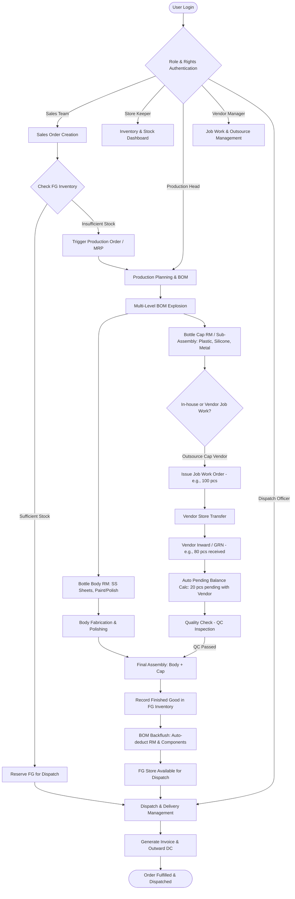
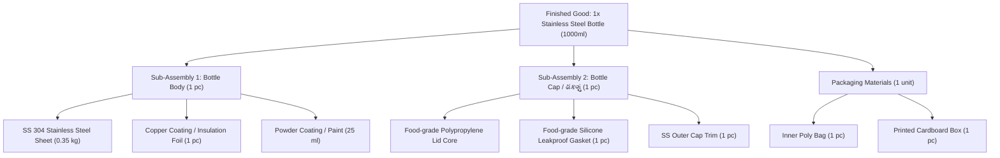
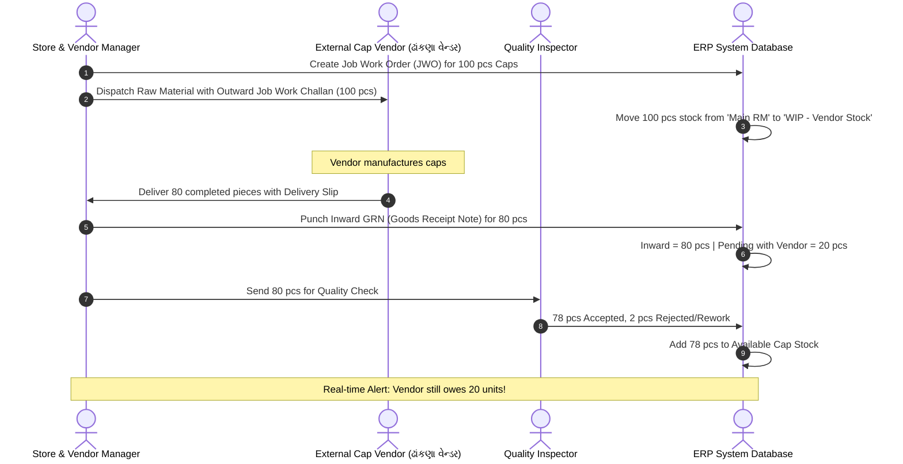
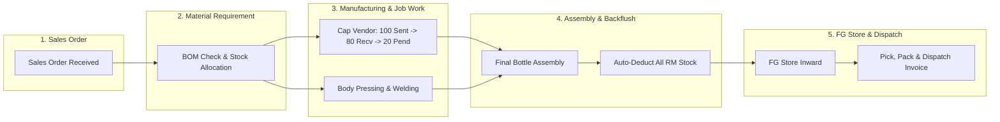

# Nanobot® - Steel Bottle Manufacturing ERP System - Workflow & Architecture Flowchart

**Company:** Nanobot® Solutions  
**Project Overview:** Manufacturing ERP Process Flow & System Architecture  
**Target Industry:** Stainless Steel Bottle Manufacturing (Assembly & Subcontracting)  
**Prepared for:** Shivanshu Sir & Operations Team  

---

## 1. Executive Summary & Flow Highlights

This workflow captures the end-to-end ERP flow for a steel bottle manufacturing plant, featuring:
1. **Role & Rights-Based Access (RBAC):** Modular dashboards for Sales, Store, Purchase, Production, Job Work, QC, and Dispatch.
2. **Sales Order (SO) to Production Planning:** Auto-check against finished goods (FG) inventory and raw material availability.
3. **Multi-Level Bill of Materials (BOM):**
   - Finished Good (Steel Bottle) = Body Assembly + Cap/Lid (ઢાંકણું) Assembly + Packaging.
   - Automated consumption/backflushing of raw materials upon FG completion.
4. **Subcontracting & Vendor Job Work (ઢાંકણું / Cap Manufacturing):**
   - Job work outward challan (e.g., 100 pieces sent).
   - Inward GRN (e.g., 80 pieces received).
   - Automatic vendor balance tracking (20 pieces pending with vendor).
5. **Store & Inventory Management:** Real-time visibility across Raw Material (RM), Work In Progress (WIP), Vendor Stock, and Finished Goods (FG).
6. **Dispatch Management:** Delivery challan, packing list, invoicing, and outward logistics.

---

## 2. High-Level Master Flowchart

---

## 3. Detailed Departmental Modules

### Module A: User Login & Role-Based Access Control (RBAC)

| Role | Permissions & Visible Modules |
| :--- | :--- |
| **Sales Executive** | Create SO, View Order Status, View FG Stock availability, Customer Master |
| **Store / Inventory Manager** | Raw Material Inward, Stock Ledger, Min/Max Reorder levels, Stock Transfer |
| **Production Supervisor** | BOM Master, Work Orders, Production Logs, Scrap Management, Assembly entry |
| **Subcontracting / Vendor Desk** | Vendor Master, Job Work Challan (Outward/Inward), Vendor Pending Ledger |
| **Quality Control (QC)** | Inward QC, In-process QC, Final FG Inspection, Rejection/Rework records |
| **Dispatch / Logistics** | Pick List, Packing Slip, Delivery Challan (DC), E-way Bill, Invoice dispatch |
| **Super Admin / Management** | Full system access, audit logs, cost analysis, vendor aging, executive reports |

---

### Module B: Multi-Level Bill of Materials (BOM) Architecture

> **Automated Backflush Rule:**  
> When **1 Bottle** is marked completed in the ERP:
> - `SS 304 Sheet`: `-0.35 kg`
> - `Bottle Cap (Finished)`: `-1 pc` (or child raw materials if made in-house)
> - `Silicone Ring`: `-1 pc`
> - `Packaging Box`: `-1 pc`
> All ledger deductions happen in real-time without manual ledger reconciliation.

---

### Module C: Vendor / Job Work Management (ઢાંકણું / Cap Vendor Tracking)

#### Job Work Accounting Table:
| Job Work Order # | Vendor Name | Component | Ordered / Sent | Inward Received | QC Passed | Vendor Pending Balance | Status |
| :---: | :---: | :---: | :---: | :---: | :---: | :---: | :---: |
| **JWO-2026-001** | Apex Polymers & Caps | Steel Bottle Cap Assembly | 100 pcs | 80 pcs | 78 pcs | **20 pcs** | Partial (Pending) |

---

### Module D: Complete Production to Dispatch Life Cycle

---

## 4. Key ERP System Entities & Database Relations

| Table Name | Primary Key | Key Columns | Purpose |
| :--- | :--- | :--- | :--- |
| **`tbl_Users`** | `User_ID` | `Username`, `Password_Hash`, `Role_ID`, `Department`, `Is_Active` | Stores user credentials & role association |
| **`tbl_Roles`** | `Role_ID` | `Role_Name`, `Permission_Bitmask`, `Allowed_Modules` | RBAC matrix enforcement |
| **`tbl_Item_Master`** | `Item_Code` | `Item_Name`, `Category (RM/WIP/FG)`, `UOM`, `Min_Stock`, `Current_Stock` | Product and raw material definitions |
| **`tbl_BOM_Header`** | `BOM_ID` | `FG_Item_Code`, `Revision`, `Effective_Date`, `Is_Active` | Multi-level recipe header |
| **`tbl_BOM_Details`** | `BOM_Detail_ID` | `BOM_ID`, `Component_Code`, `Qty_Per_Unit`, `Scrap_Pct`, `Is_Outsourced` | Component ratios (0.35kg sheet, 1 cap, 1 box) |
| **`tbl_Vendor_Master`** | `Vendor_ID` | `Vendor_Name`, `GSTIN`, `Specialization`, `Contact_Person`, `Rating` | Approved subcontracting vendor profiles |
| **`tbl_Job_Work_Challans`** | `Challan_ID` | `Vendor_ID`, `Qty_Sent (100)`, `Qty_Recv (80)`, `Qty_Pending (20)`, `Status` | Subcontracting tracking & GST Sec 143 compliance |
| **`tbl_Stock_Ledger`** | `Txn_ID` | `Item_Code`, `Warehouse_ID`, `Txn_Type (IN/OUT)`, `Qty`, `Running_Bal` | Atomic perpetual inventory ledger (BOM backflush) |
| **`tbl_Sales_Orders`** | `SO_ID` | `Customer_ID`, `Item_Code`, `Ordered_Qty`, `Allocated_Qty`, `Status` | Customer order intake & allocation |
| **`tbl_Dispatch_Records`** | `Dispatch_ID`| `SO_ID`, `Invoice_No`, `Eway_Bill_No`, `Vehicle_No`, `Dispatch_Date` | Statutory billing & outward logistics |

---

## 5. Granular 22-Box Process Matrix (Every Step in Detail)

### Phase 1: Authentication & Role-Based Access Control (RBAC)
- **Box 1.1 (`SEC-01`): User Login & Credential Verification**
  - *Inputs:* Username, Encrypted Password, Device Token.
  - *Process:* Authenticates credentials against `tbl_Users`, enforces MFA, and issues JWT session token.
  - *Outputs:* Authenticated session with mapped `Role_ID`.
- **Box 1.2 (`SEC-02`): Role & Permission Enforcement Engine**
  - *Inputs:* `Role_ID`, requested route, action type.
  - *Process:* Filters menus and data access: Sales sees orders/FG stock (restricted from RM purchase costs); Store sees physical stock; Production sees recipes/assembly; Vendor desk sees subcontracting challans.
  - *Outputs:* Departmental workspace rendering.

### Phase 2: Sales Order & Inventory Allocation
- **Box 2.1 (`SO-01`): Sales Order Creation & Commercial Approval**
  - *Inputs:* Customer PO, Model (SS-1000), Quantity (e.g. 500 units), Delivery Date.
  - *Process:* Validates customer credit limit, applies GST pricing, generates `#SO-2026-XXXX`.
  - *Outputs:* Confirmed Sales Order document.
- **Box 2.2 (`SO-02`): Finished Goods Inventory Lookup**
  - *Inputs:* `Item_Code: FG-SS-1000`, Ordered Qty.
  - *Process:* Compares requested quantity against `Current_Stock - Reserved_Stock`. If in stock ➔ reserves goods for dispatch. If deficit ➔ triggers MRP.
  - *Outputs:* Stock Allocation Slip OR Production Shortage Requisition.
- **Box 2.3 (`MRP-01`): Material Requirement Planning (MRP) Run**
  - *Inputs:* Net bottle production needed, Active BOM.
  - *Process:* Computes gross raw material requirements (SS sheet, caps, gaskets, packaging). Compares with current RM stores and generates Work Orders & Purchase/Job-Work orders.
  - *Outputs:* Shopfloor Work Orders & Job Work Requisitions.

### Phase 3: Multi-Level Bill of Materials (BOM) Architecture
- **Box 3.1 (`BOM-01`): Finished Good Header (`FG-SS-1000`)**
  - *Formula:* 1 Finished Bottle = 1 Bottle Body + 1 Bottle Cap (ઢાંકણું) + 1 Packaging Unit.
- **Box 3.2 (`BOM-02`): Sub-Assembly 1 - Bottle Body**
  - *Composition:* SS 304 Sheet (0.350 kg) + Copper Foil (1 pc) + Powder Coating (25 ml).
- **Box 3.3 (`BOM-03`): Sub-Assembly 2 - Cap / ઢાંકણું (Outsourced)**
  - *Composition:* Polypropylene Core (1 pc) + Silicone Seal Gasket (1 pc) + SS Trim (1 pc).
- **Box 3.4 (`BOM-04`): Sub-Assembly 3 - Packaging Unit**
  - *Composition:* Poly Protective Sleeve (1 pc) + Printed Outer Monocarton Box (1 pc).

### Phase 4: Vendor Subcontracting & Job Work Tracking (ઢાંકણું)
- **Box 4.1 (`JW-01`): Vendor Selection from Master**
  - *Inputs:* Component requirement (Caps), Vendor Master.
  - *Process:* Selects registered subcontractor (Apex Polymers & Molders), validates GSTIN and rate contract.
  - *Outputs:* Linked Vendor Subcontracting Profile.
- **Box 4.2 (`JW-02`): Job Work Order & Outward Delivery Challan (100 Pcs)**
  - *Inputs:* JWO #JWO-2026-089, Quantity: 100 Pieces.
  - *Process:* Generates statutory GST Challan. Transfers 100 units from `Main RM Store` to `WIP - Subcontractor Stock (Apex Caps)`.
  - *Outputs:* 3-part GST Delivery Challan & gate outward slip.
- **Box 4.3 (`JW-03`): Factory Gate Inward GRN (80 Pcs Received)**
  - *Inputs:* Delivery slip from vendor with 80 completed caps.
  - *Process:* Security logs vehicle arrival; Inward Clerk generates Goods Receipt Note (GRN) for 80 pieces into quarantine bay.
  - *Outputs:* GRN Document `#GRN-2026-142`.
- **Box 4.4 (`JW-04`): ⚡ Automated Pending Balance Calculation (20 Pcs PENDING)**
  - *Inputs:* Challan Dispatched Qty (100) vs GRN Inward Qty (80).
  - *Process:* `Pending_Qty = 100 - 80 = 20 Pieces`. System flags vendor ledger with 20 outstanding liability and starts automated follow-up timer.
  - *Outputs:* Vendor Outstanding Ledger updated; Warning alert rendered on dashboard.
- **Box 4.5 (`JW-05`): Inward Quality Inspection (AQL 1.0)**
  - *Inputs:* 80 units from inward bay.
  - *Process:* Torque, leak, and odor test. Result: 78 units accepted ➔ moved to Assembly Store; 2 units rejected ➔ debited to vendor rework.
  - *Outputs:* QC Acceptance Certificate.

### Phase 5: In-House Flask Body Production Line
- **Box 5.1 (`PRD-01`): SS Sheet Blanking & Deep Drawing**
  - *Inputs:* SS 304 coils (0.35kg/bottle). Multi-stage hydraulic press forms inner and outer vessels.
- **Box 5.2 (`PRD-02`): Laser Welding & Vacuum Annealing**
  - *Inputs:* Inner flask + Outer flask + Copper wrap. Welded and heated in vacuum furnace to 10^-4 Torr.
- **Box 5.3 (`PRD-03`): Surface Polishing & Powder Coating**
  - *Inputs:* Vacuum-tested bodies. Ultrasonic wash and electrostatic coating cured at 180°C.

### Phase 6: Final Assembly & Automated BOM Backflush
- **Box 6.1 (`ASY-01`): Final Assembly**
  - *Inputs:* 1 Body + 1 Cap (ઢાંકણું) + 1 Silicone Ring + 1 Box. 100% pneumatic seal test.
- **Box 6.2 (`ASY-02`): Finished Goods Production Inward**
  - *Inputs:* Completed batch (+100 Finished Bottles) logged by supervisor.
  - *Outputs:* Finished Goods Warehouse Credit (`+100 units FG-SS-1000`).
- **Box 6.3 (`ASY-03`): ⚡ Automated BOM Backflush (Auto-Deduction Engine)**
  - *Inputs:* `+100 FG Bottles` logged into inventory.
  - *Atomic Deductions:*
    - `SS 304 Sheet`: `100 * 0.35kg = -35.00 kg` from RM Store
    - `Bottle Caps (ઢાંકણા)`: `100 * 1 = -100 units` from WIP Store
    - `Silicone Gaskets`: `100 * 1 = -100 units` from RM Store
    - `Powder Paint`: `100 * 25ml = -2,500 ml` from Consumables
    - `Printed Boxes`: `100 * 1 = -100 units` from Packaging Store
  - *Outcome:* Zero manual ledger entries needed!

### Phase 7: Store Management, Invoicing & Dispatch
- **Box 7.1 (`STR-01`): Warehouse Bin Allocation**
  - Finished bottles assigned to specific rack/shelf bins; available for sales allocation.
- **Box 7.2 (`DSP-01`): Digital Pick List & Master Carton Packing**
  - QR barcode scan of bottles packed into 24-unit master corrugated shippers.
- **Box 7.3 (`DSP-02`): Tax Invoicing & GST E-Way Bill Generation**
  - Generation of statutory GST Tax Invoice (HSN 7323) and 12-digit E-Way bill via API.
- **Box 7.4 (`DSP-03`): Outward Gate Pass & Customer Dispatch**
  - Factory gate security verification, outward gate pass stamping, order marked FULFILLED.

---

## 6. React & Tailwind Application Architecture

The interactive application is built with **React 18** and **Tailwind CSS**, featuring:
- **`src/data/flowchartData.js`**: Master data structures for all 22 boxes, 7 phases, and role permissions.
- **`src/components/FlowchartCanvas.jsx`**: Visual flowchart with clickable box inspector.
- **`src/components/VendorJobWorkSimulator.jsx`**: Real-time subcontracting calculator (100 sent ➔ 80 inward ➔ 20 pending).
- **`src/components/BOMBackflushSimulator.jsx`**: Real-time multi-level stock auto-deduction engine.
- **`src/components/RBACMatrixView.jsx`**: Interactive Role & Rights access simulator.
- **`src/components/DatabaseSchemaView.jsx`**: Relational entity-relationship table layouts.

### Live Server:
The application is running live at: **`http://localhost:5173/`**  
Production build assets are compiled in: `c:\ERP Flowchart\dist\`

